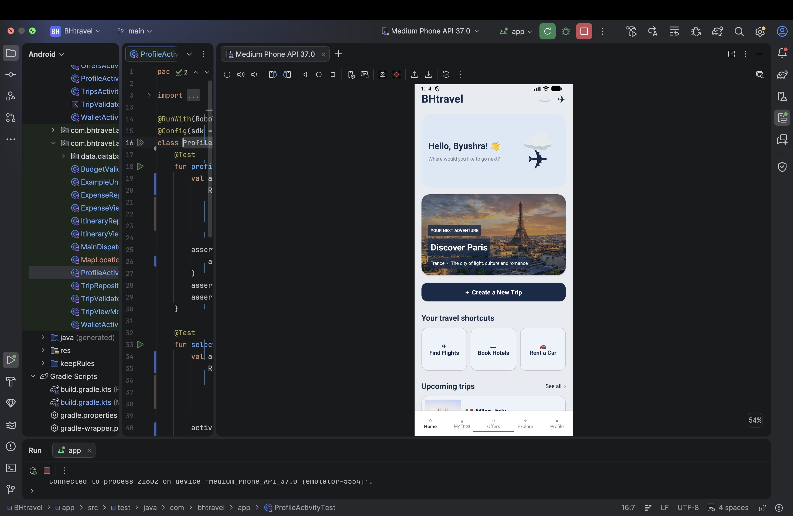
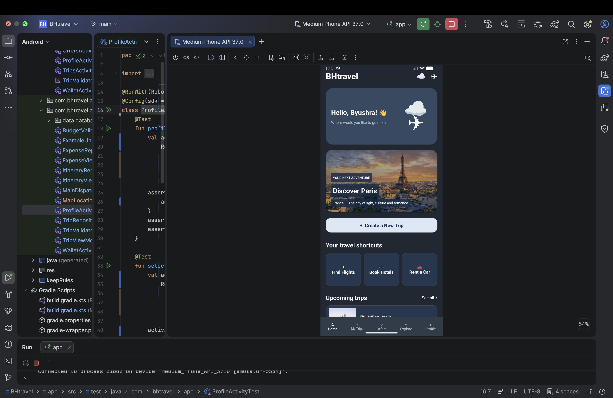
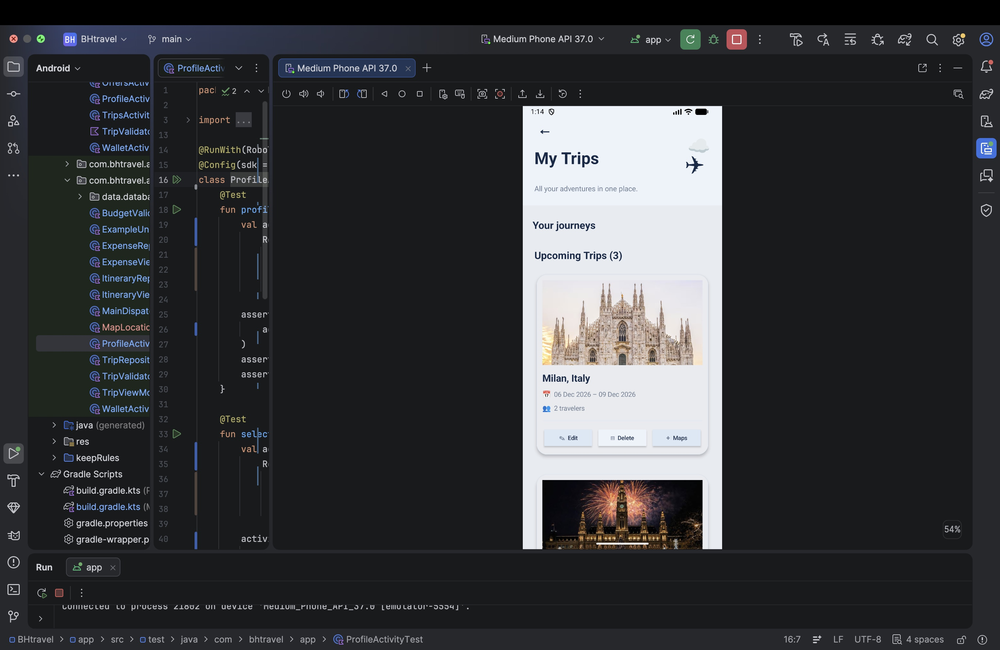
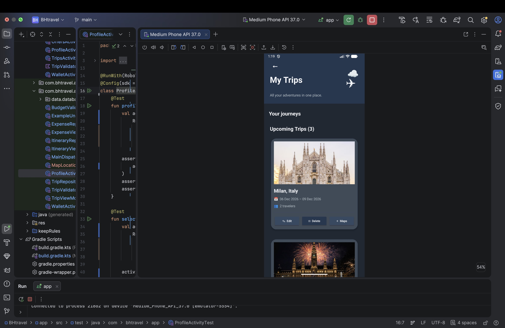
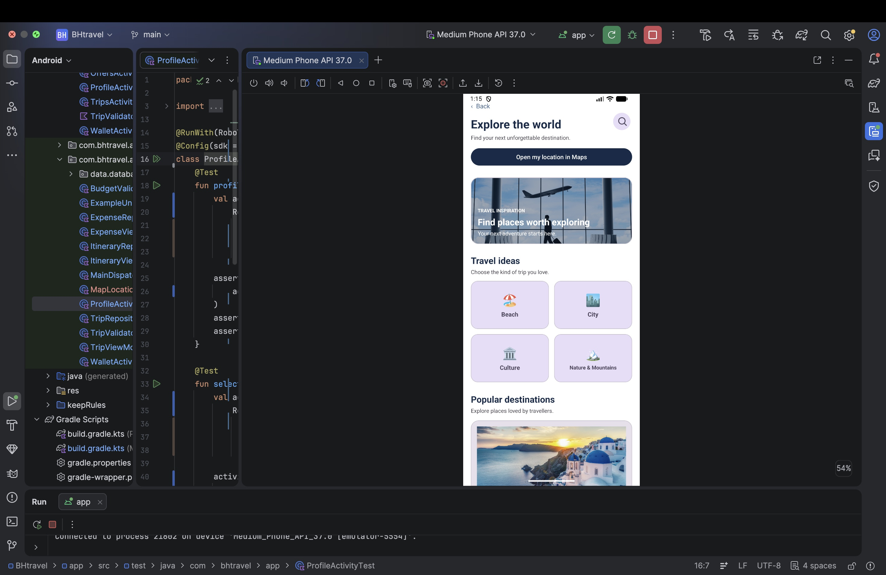
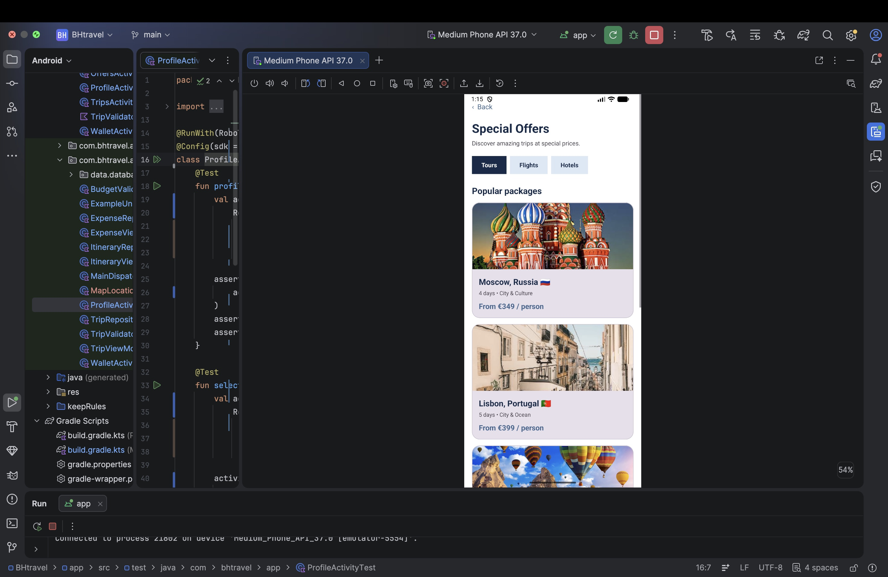
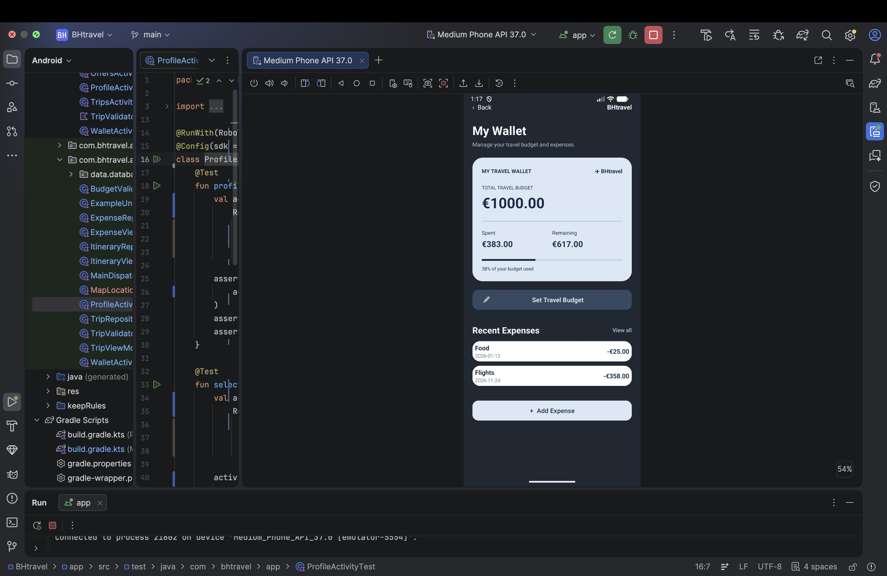
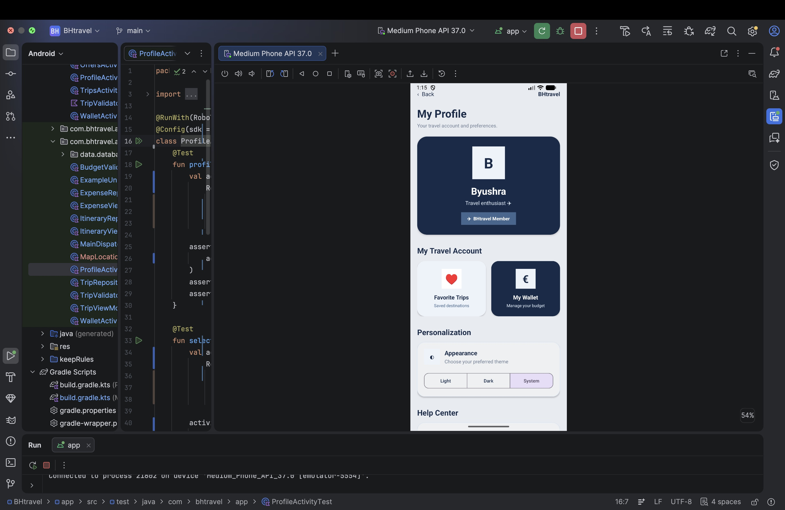
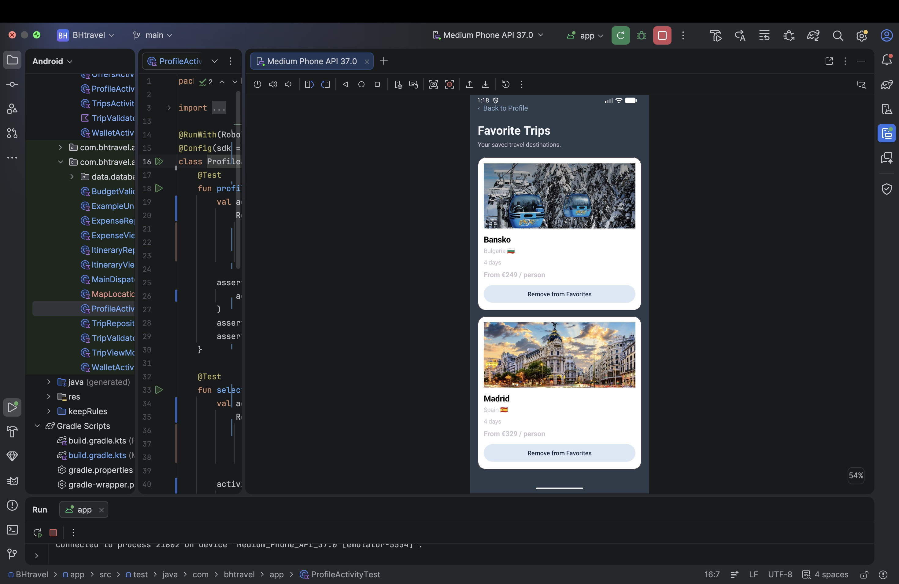

# BHtravel – Android Travel Planner

## 1. Идея на проекта

BHtravel е мобилно приложение за Android, предназначено за планиране и организиране на пътувания. То обединява на едно място управлението на пътувания, разглеждането на туристически дестинации и проследяването на разходи.

Основната идея е да предостави на потребителите лесен и удобен начин да организират своите пътувания чрез модерен интерфейс и функционалности за управление на информацията.

## 2. Как работи

При стартиране на BHtravel потребителят попада на началния екран Home, откъдето може да премине към основните секции на приложението.

В секцията My Trips потребителят може да добавя нови пътувания, като въвежда дестинация, държава, начална и крайна дата, брой пътуващи и допълнителни бележки. Създадените записи могат да бъдат разглеждани, редактирани и изтривани. Информацията се съхранява локално чрез Room Database и остава налична след повторно стартиране на приложението. При изтриване на пътуване свързаните разходи и активности от itinerary се изтриват в една транзакция. От бутона **Plan trip itinerary** се отваря планът с активности за пътуванията; елементите могат да бъдат добавяни, редактирани и изтривани.

Секцията Explore предоставя възможност за разглеждане на дестинации, организирани в категории Beach, City, Culture и Nature & Mountains. За избрани места може да се отвори Google Maps. Бутонът „Open my location in Maps“ използва разрешение за местоположение и текущата GPS/мрежова позиция, за да отвори координатите в Maps.

В секцията Offers потребителят може да разглежда туристически предложения и да преминава към външни платформи за полети и хотели.

Секцията Wallet позволява задаване на бюджет, добавяне на разходи и проследяване на изразходваната и оставащата сума.

В Profile потребителят може да управлява настройките на приложението, включително избора между Light Mode и Dark Mode.

От Profile може да се отвори **Favorite Trips**. Любимите туристически предложения се запазват локално и могат да бъдат премахнати от списъка.

## 3. Архитектура

Приложението е разработено с Kotlin и XML и използва Room за локално съхранение на данни.

Основните архитектурни компоненти са:

- **Model** – представя данните и обектите в приложението.
- **View** – XML интерфейсите и Activity класовете, чрез които потребителят взаимодейства с приложението.
- **ViewModel** – управлява данните, свързани с интерфейса.
- **Repository** – организира достъпа до данните.
- **Room Database** – осигурява локално съхранение на информацията.

Използваните технологии включват Kotlin, Android SDK, XML Layouts, Room Database и Material Design 3.

## 4. Потребителски поток

Основният потребителски поток е:

1. Потребителят стартира приложението и отваря Home.
2. Избира My Trips, за да създаде или управлява пътувания.
3. Въвежда информация за пътуването и запазва записа.
4. Отваря **Plan trip itinerary**, за да добави и управлява активности.
5. Използва Explore, за да разглежда дестинации и да отвори текущото си местоположение в Maps.
6. Отваря Offers, за да разгледа предложения и да запази любими от Profile → Favorite Trips.
7. Използва Wallet, за да зададе бюджет и да следи разходите.
8. Отваря Profile, за да промени настройките и темата на приложението.

## 5. Стъпки за стартиране

1. Инсталирайте Android Studio.
2. Клонирайте GitHub хранилището.
3. Отворете проекта в Android Studio.
4. Изчакайте Gradle Sync да приключи.
5. Стартирайте Android Emulator или свържете Android устройство.
6. Изберете Run, за да стартирате приложението.

**Изисквания:**
- Android Studio
- Android SDK
- Минимална версия на Android: API 24

## 6. Тестови акаунти

Приложението не изисква регистрация или влизане с потребителски акаунт. Основните функционалности могат да бъдат тествани директно след стартиране.

## 7. Скрийншотове

По-долу са показани екранни снимки от приложението в светла и тъмна тема.

| Екран | Изображение |
|---|---|
| Home – Light |  |
| Home – Dark |  |
| My Trips – Light |  |
| My Trips – Dark |  |
| Explore |  |
| Offers |  |
| Wallet |  |
| Profile – Light |  |
| Favorite Trips – Dark |  |

## 8. APK

Готовият инсталационен файл на приложението е:

`apk/app-release.apk`

**Инсталиране:** Изтеглете APK файла на Android устройство и го отворете, за да инсталирате приложението.
